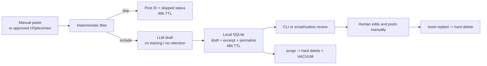

# Architecture

## Data flow

## Trust boundaries

- **Reddit**: read-only public posts. OAuth application-only token, `read` scope only.
- **LLM API**: receives the public post text and returns a draft. Use a no-training/zero-retention provider.
- **Local queue**: SQLite and email/outbox. The operator controls both.
- **Human**: the only actor allowed to publish. The tool has no write path to Reddit.

## Reddit adapter rules

- Endpoint: `GET https://oauth.reddit.com/r/Optics/new?limit=100&raw_json=1`.
- Optional rules endpoint: `GET https://oauth.reddit.com/r/Optics/about/rules`.
- Poll at most once per 10 minutes.
- Free-tier limit: 100 QPM per OAuth client ID; this design uses about 6 requests/hour.
- Monitor `X-Ratelimit-Used`, `X-Ratelimit-Remaining`, and `X-Ratelimit-Reset`.
- On 429/5xx, back off with jitter; never retry aggressively.
- No `/api/comment`, `/api/vote`, `/api/submit`, `/api/compose`, or moderation endpoints.

## Approval gate

`REDDIT_API_APPROVED` defaults to `false`. The adapter raises `RedditNotApproved` before making any data request. Set it to `true` only after Reddit has approved the use case in writing.

## Data minimization

The persisted schema intentionally has no author column and no full-body column. Drafts and excerpts are the only content-bearing fields, and they expire within 48 hours. The outbox is local and purgeable.
